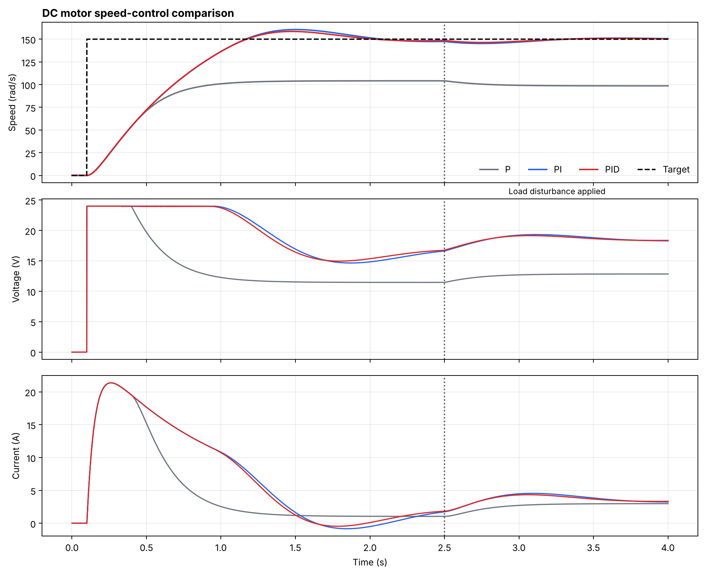

# DC Motor Modelling and PID Speed Control

A physics-based Python simulation of a permanent-magnet DC motor with a closed-loop
speed controller. It models the motor's coupled electrical and mechanical dynamics,
solves them numerically with a fourth-order Runge–Kutta (RK4) integrator, and compares
**P, PI and PID control**. Each controller gets a speed step command, and later a
sudden load torque is applied.



## Engineering question

How do the proportional, integral and derivative terms change a motor's response to
a speed command and to an unexpected mechanical load, when the supply voltage is limited?

## Key results

Test scenario: 150 rad/s speed command at t = 0.10 s, a 0.20 N·m load torque at
t = 2.50 s, and a 24 V supply limit.

| Controller | Rise time (s) | Overshoot (%) | Settling time, ±2% (s) | Final error (rad/s) | Load recovery (s) |
|------------|--------------:|--------------:|-----------------------:|--------------------:|------------------:|
| P          | not reached   | 0.0           | not reached            | 51.38               | not reached       |
| PI         | 0.776         | 7.07          | 1.831                  | 0.70                | 0.519             |
| PID        | 0.777         | 5.68          | 1.748                  | 0.32                | 0.417             |

- **P only cannot reach the target.** It levels off at about 104 rad/s, which is a
  steady-state error of more than 30%. Under load it falls further, to about 99 rad/s.
  This is the expected steady-state error of a type-0 loop under proportional control.
- **Adding integral action (PI) removes the steady-state error.** The integral term builds
  up the extra voltage needed to hold the target speed and to reject the load torque.
- **Adding derivative action (PID) adds damping.** Compared with PI, overshoot falls from 7.1% to
  5.7%, settling is about 0.08 s faster, and recovery after the load is about 20% quicker
  (0.42 s vs 0.52 s). The speed dip under load is also smaller (about 3.7 vs 4.8 rad/s).
- **Actuator saturation matters.** For the first ~0.85 s of the step the controller asks for
  more than the 24 V supply can give, so the voltage stays at its limit. Anti-windup stops
  the integral term from building up during this time, which would otherwise cause
  much larger overshoot.

## Features

- Coupled armature-current and rotor-speed differential equations
- Fixed-step fourth-order Runge–Kutta integration (1 ms time step)
- Discrete PID controller with **voltage saturation** and **conditional-integration anti-windup**
- Load-torque disturbance applied mid-simulation
- Automatic performance metrics: 10–90% rise time, overshoot, ±2% settling time,
  steady-state error and disturbance-recovery time
- Unit tests, plus a single script that recreates every result and figure

## Motor model

State: armature current `i` [A] and angular speed `ω` [rad/s].

```text
L · di/dt = V − R·i − Kₑ·ω          (electrical: applied voltage, resistive drop, back-EMF)
J · dω/dt = Kₜ·i − b·ω − τ_load      (mechanical: motor torque, viscous friction, load)
```

| Parameter | Symbol | Value |
|-----------|--------|-------|
| Armature resistance | R | 1.0 Ω |
| Armature inductance | L | 0.05 H |
| Torque constant | Kₜ | 0.1 N·m/A |
| Back-EMF constant | Kₑ | 0.1 V·s/rad |
| Rotor inertia | J | 0.01 kg·m² |
| Viscous friction | b | 0.001 N·m·s/rad |
| Supply voltage limit | V_max | ±24 V |

## Controller

```text
e(t) = ω_target − ω
V    = clip( Kp·e + Ki·∫e dt + Kd·de/dt ,  −V_max, +V_max )
```

The integral is only updated when doing so would not push an already-saturated output
further into saturation (conditional integration). This is a simple and robust
anti-windup method.

| Controller | Kp | Ki | Kd |
|------------|----|----|----|
| P   | 0.25 | –   | –      |
| PI  | 0.22 | 1.2 | –      |
| PID | 0.28 | 1.4 | 0.0015 |

## Tech stack

Python 3.10+ · NumPy · pandas · Matplotlib · pytest

## Getting started

```bash
python -m venv .venv
source .venv/bin/activate          # Windows: .venv\Scripts\activate
python -m pip install -r requirements.txt

python scripts/run_simulation.py   # run all three controllers, write results to outputs/
python -m pytest                   # run the test suite
```

The simulation can also be used as a library:

```python
from motor_control import MotorParameters, PIDGains, simulate, response_metrics

data = simulate(PIDGains(kp=0.28, ki=1.4, kd=0.0015), MotorParameters(), target_speed=100.0)
print(response_metrics(data))
```

## Project structure

```text
dc-motor-pid-control/
├── src/motor_control/
│   ├── __init__.py
│   └── model.py             # motor ODEs, RK4 integrator, PID loop, response metrics
├── scripts/
│   └── run_simulation.py    # runs P / PI / PID comparison, writes figure and tables
├── tests/
│   └── test_model.py
├── outputs/                 # generated figure, metrics CSV and summary
├── pyproject.toml
└── requirements.txt
```

## Testing

- With no speed command, the motor stays stationary
- Controller output never exceeds the supply voltage limit, even with very aggressive gains
- The PID controller tracks the speed target to within the expected error
- Invalid simulation settings (e.g. zero time step) are rejected

## Limitations

This is a simulation study, not a hardware implementation.

- Motor parameters are constant. Temperature-dependent resistance, brush effects, magnetic
  saturation and cogging are not modelled.
- Rigid shaft and ideal load. There is no gearbox backlash or shaft compliance.
- Ideal sensing and actuation. There is no encoder quantisation, measurement noise, sensor delay or
  PWM switching. A real derivative term would need filtering to avoid amplifying noise.
- The gains were tuned by hand to show the behaviour of each term. They are not optimised for a
  particular physical motor.

## Possible extensions

- Systematic tuning (Ziegler–Nichols, pole placement or optimisation-based)
- Frequency-domain analysis: transfer function, Bode plot, gain and phase margins
- Encoder noise and a filtered derivative term
- Cascaded current/speed control loops, as used in industrial drives
- Validation against a real motor with system identification
